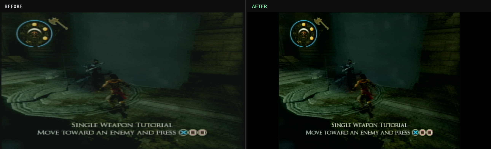
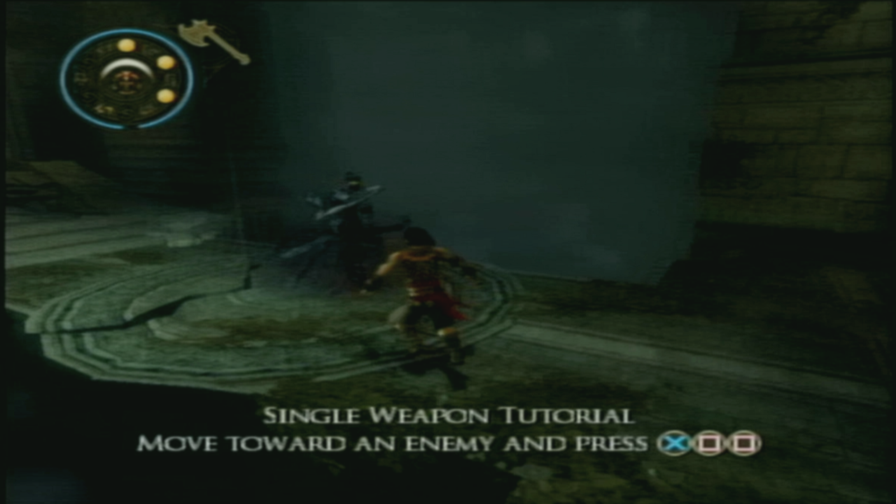
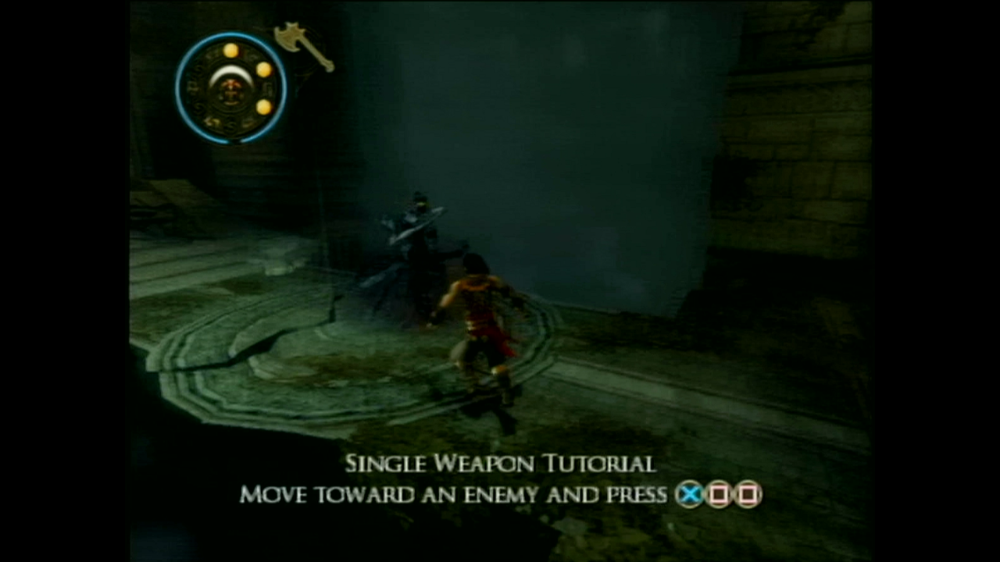

# ps2-linux-capture

Scripts I use to play my PlayStation 2 (`SCPH-90004`) on my Linux laptop through a MacroSilicon MS2109 (`534d:2109`) USB capture card and a PS2-to-HDMI adapter.

Opening the capture card in OBS or VLC had ~300ms of input lag, defaulted to 1080p@30fps, stretched 4:3 games to 16:9, didn't route audio automatically, and had a loud 50/60Hz ground-loop hum plus washed-out analog black levels. `play-ps2.sh` wraps `ffplay` and `ffmpeg` to clean up the video and audio signal path in real time with minimal latency.

## What it does

- **Low-latency 60Hz capture**: Forces the MS2109 into `1280x720 @ 60Hz` (`mjpeg`) or `720x480 @ 60Hz` (`yuyv422`) with `ffplay -fflags nobuffer -flags low_delay -framedrop`.
- **480i cleanup & 4:3 aspect correction**: Applies `bwdif` deinterlacing, clips the raised analog black floor without crushing shadow detail (`colorlevels` + `gamma`), denoises chroma grain (`hqdn3d`), sharpens edges gently (`cas=0.35`), and locks the display aspect ratio to `4:3`.
- **Audio hum removal**: Routes the MS2109 USB audio input through PipeWire/PulseAudio with notch filters at `50/60/100/120/150/180 Hz` and an FFT denoiser (`afftdn`) to kill ground-loop buzz from the PS2-to-HDMI adapter.

## Usage

```bash
./play-ps2.sh                      # 4:3 + bwdif deinterlace + black-level/gamma fix + anti-hum audio
./play-ps2.sh --16:9               # 16:9 widescreen (for games with native widescreen enabled)
./play-ps2.sh 720x480 60 yuyv422   # uncompressed YUYV at native 480p
./play-ps2.sh --raw                # raw unfiltered video and audio
```

Run `./scripts/diagnose.sh` to check USB enumeration (`534d:2109`), V4L2/PipeWire device nodes, and inspect the audio hum spectrum.

Controls inside `ffplay`: `f` to toggle fullscreen, `q` or `ESC` to quit (also stops the background audio stream).

## Screenshots (*Prince of Persia: Warrior Within*)



**Raw capture (`--raw`, 16:9 stretched):**


**Filtered 4:3 output (`./play-ps2.sh`):**


## Notes for PS2 + MS2109

- **PS2 BIOS settings**: Set `Component Video Out` to `Y Cb/Pb Cr/Pr`. Hold `Triangle + X` after the PS2 boot logo in supported games to enable `480p` progressive scan.
- **USB error `-71`**: If the capture card drops off `lsusb` with `device not accepting address, error -71` in `dmesg`, unplug and reseat it directly in a laptop USB port (avoid unpowered hubs).
- **Color bars**: If you only see SMPTE color bars, the capture card is powered by the laptop but isn't getting an HDMI clock from the PS2-to-HDMI adapter (check the adapter's 5V USB power cable).
